# Stay Flow

[](https://github.com/Ahmad-Mosha/stay-flow/actions/workflows/ci.yml)

A booking platform for small hotels: a direct-booking site for guests and a front desk app for the
people who run the hotel. Under the screens is a backend built so that one room can never be sold
twice, whatever the timing: PostgreSQL enforces it, and concurrency tests prove it.

**Live demo:** [stayfloww.duckdns.org](https://stayfloww.duckdns.org). Book a room at
[Dar Nubia](https://stayfloww.duckdns.org/stay/dar-nubia), or
[sign in](https://stayfloww.duckdns.org/sign-in) as `host@example.com` with the password
`nubia-demo-password` to run the front desk.

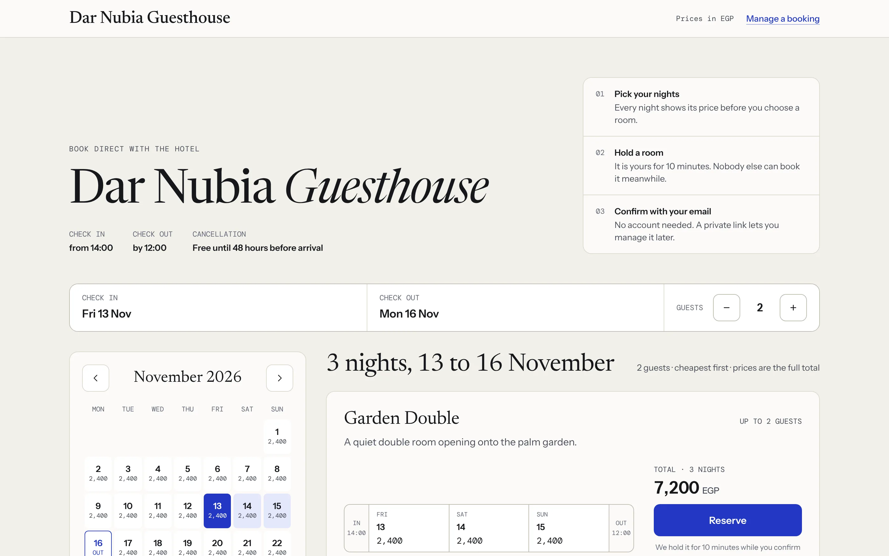

**Stack:** TypeScript everywhere. NestJS, Kysely and PostgreSQL 18 on the backend; Next.js 16,
React Aria and Tailwind CSS 4 on the frontend; Zod contracts shared by both. Vitest,
Testcontainers, Playwright and axe for tests. Docker Compose runs the whole stack.

## What it does

**For guests**

- A price calendar that shows what every night costs before you pick a room.
- Reserve, and the room is held for you for 10 minutes while you enter your details.
- Book with just an email address. The confirmation email carries a private link to view or cancel
  the booking, free until 48 hours before arrival.
- Payment is simulated: no card is needed, and the checkout says so.

**For the hotel**

- **Today**: tonight's occupancy, arrivals to check in, departures to check out, and who is in house.
- **Calendar**: every room across two weeks to a month. Drag across empty nights to block a room;
  arrow keys move between stays.
- **Reservations**: search by guest or reference, filter by status, and open the full history of a
  booking.
- **Rooms, Rates, Settings and Team**: room types and rooms, base and seasonal prices, check-in
  times, stay lengths and the cancellation window, and staff with owner, manager and front desk
  roles.
- Sign up, create a property, and the setup guide takes you to your first booking page.

## Screenshots

<table>
  <tr>
    <td>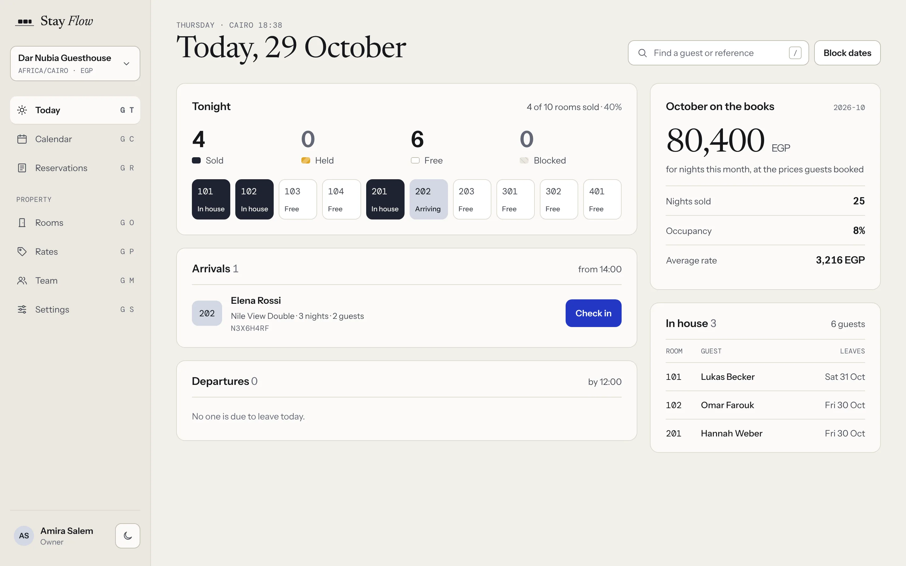</td>
    <td>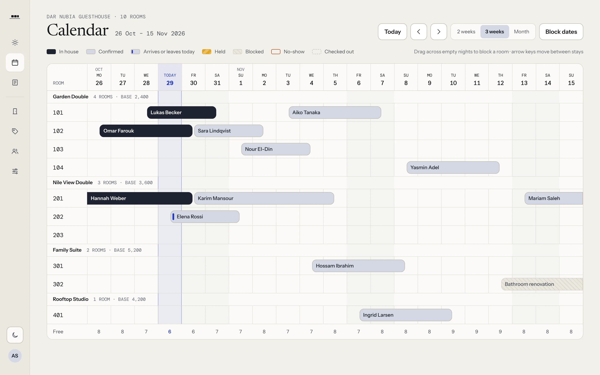</td>
  </tr>
  <tr>
    <td align="center">Today, the front desk's start page</td>
    <td align="center">The room calendar</td>
  </tr>
  <tr>
    <td>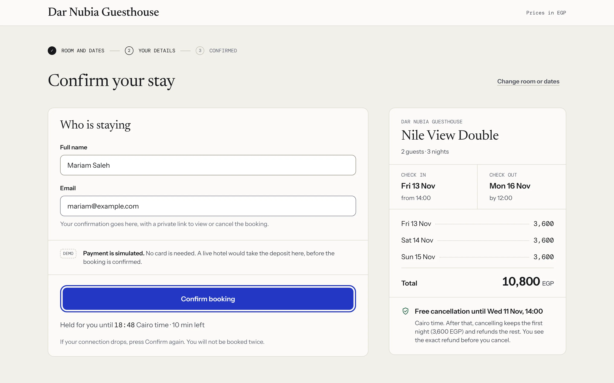</td>
    <td>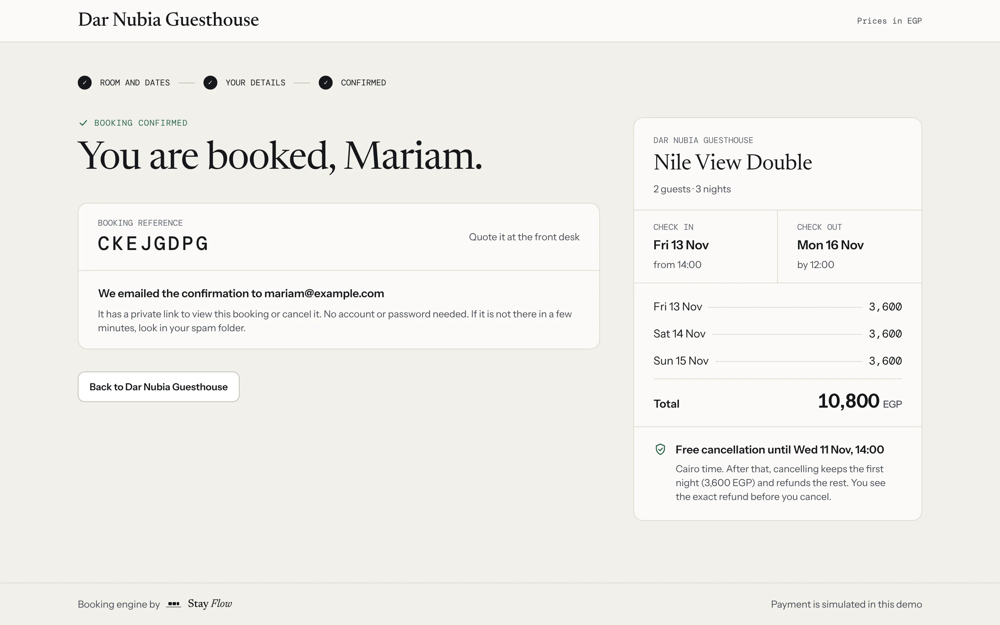</td>
  </tr>
  <tr>
    <td align="center">Checkout, while the room is held</td>
    <td align="center">Booking confirmed</td>
  </tr>
  <tr>
    <td>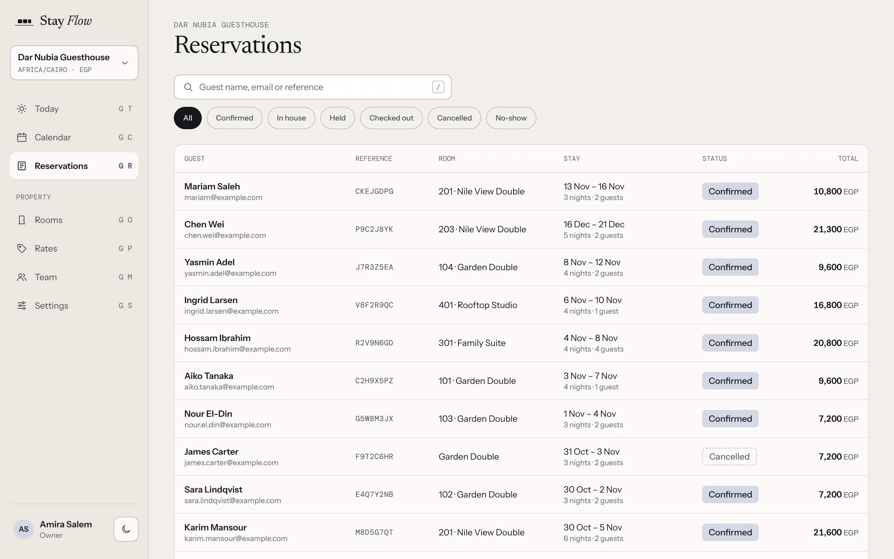</td>
    <td>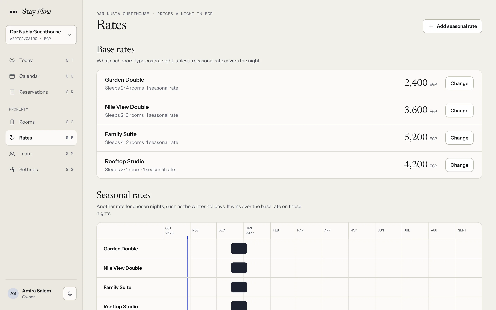</td>
  </tr>
  <tr>
    <td align="center">Reservations</td>
    <td align="center">Rates and seasonal prices</td>
  </tr>
  <tr>
    <td>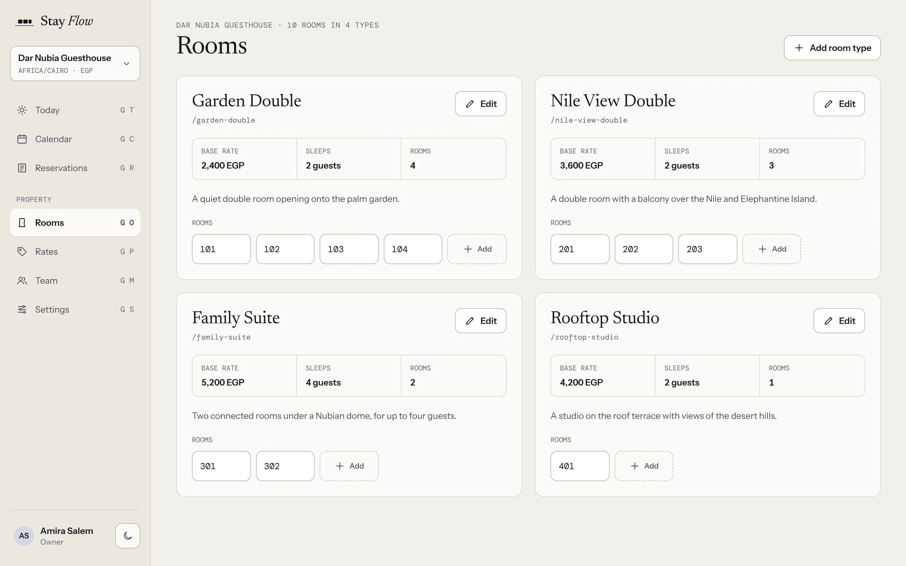</td>
    <td>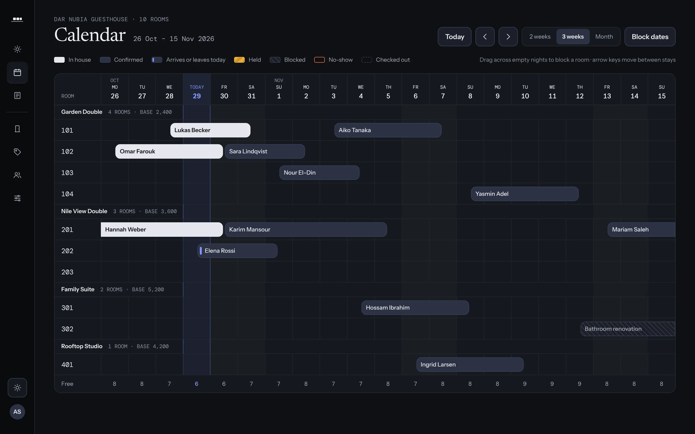</td>
  </tr>
  <tr>
    <td align="center">Rooms</td>
    <td align="center">Dark theme</td>
  </tr>
</table>

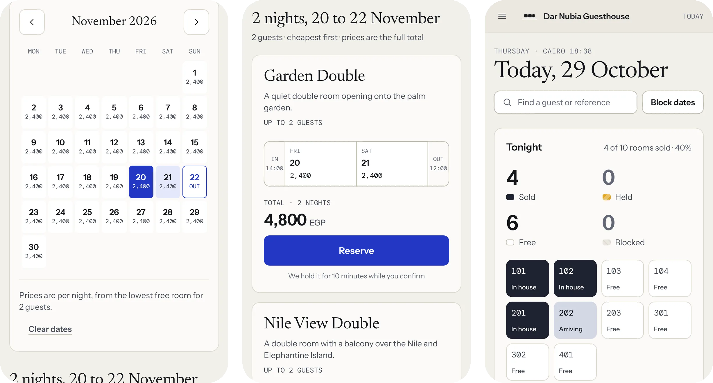

## Engineering highlights

### No double booking, enforced by the database

Every night a room is taken, by a guest or by a block, is a row in `occupancies`. An exclusion
constraint makes overlapping rows for one room impossible:

```sql
CONSTRAINT occupancies_no_overlap EXCLUDE USING gist (unit_id WITH =, nights WITH &&)
  WHERE (released_at IS NULL)
```

So the guarantee does not depend on application code getting a check-then-insert race right. When a
guest reserves, the API orders the free rooms of that type best fit first (rooms that close a gap
before rooms that break up a long free run), then tries to take each one inside a savepoint. If
another booking got there first, Postgres rejects the insert, and the API moves on to the next room.
Writers lock the room row first, so racing inserts queue up instead of deadlocking.

The concurrency tests run real races against a real database, for example:

- gives the last free room to exactly one of 50 simultaneous holds;
- lets either a host block or a guest hold have the last room, never both;
- lets either the guest cancel or the front desk check them in, never both;
- never lets both the hold sweeper and the guest's confirm win, whatever the timing.

### Holds, retries and idempotency

A hold reserves the room for 10 minutes. Expired holds are released lazily when they get in the
way, and a sweeper releases the rest. Holding and confirming take an `Idempotency-Key`, so a retried
request returns the first response instead of booking twice: 10 identical requests at once create
one hold. Prices and the cancellation policy are copied onto the booking, so a later price change
never changes what a guest agreed to pay. Money is stored in minor units, never as floats.

### Emails through a transactional outbox

A booking and its "send the confirmation email" event commit in the same transaction, so there is
never a booking without its email, or an email for a booking that rolled back. A separate worker
process claims events with `FOR UPDATE SKIP LOCKED` under a lease, retries failures with backoff,
and fences its writes: once a lease runs out and another worker takes the event, the first worker's
writes match nothing. Every event keeps the ID of the request that caused it, so the logs of one
booking can be followed from the API into the worker.

### Hotel time

Dates are hotel dates, in the property's time zone, handled with Temporal. At 04:00 property time a
night audit marks missed arrivals as no-shows, as a real hotel does. A housekeeping job deletes rows
that have done their job, such as expired sessions and delivered events, in small batches.

### Security and access

- Sessions without a framework: argon2id passwords (OWASP baseline parameters, from `node:crypto`),
  random 256-bit tokens stored only as hashes, and a `__Host-session` cookie over HTTPS.
- Rate limits on sign-in and sign-up, kept in Postgres so they hold across instances.
- A cross-origin guard on every request that changes data.
- Role-based access per property. Someone outside the property gets 404, not 403, so property IDs
  reveal nothing.

### One contract, checked three ways

Request and response shapes are Zod schemas in `packages/contracts`. The API validates with them,
the web app types its calls with them, and the OpenAPI document is generated from them (served at
`/v1/openapi.json`, with interactive docs at `/v1/docs`). Every integration test checks each response
against that document, so the docs cannot drift from what the API returns.

### Ready to operate

Prometheus metrics (HTTP latency, holds, booking conflicts, outbox backlog and lag), health and
readiness endpoints, structured JSON logs with request IDs, and a graceful shutdown that stops
reporting ready, then finishes the requests in flight before it exits.

### Accessible by default

Built on React Aria, keyboard first (press `G` then `C` for the calendar), light and dark themes. The
end-to-end suite runs axe against every page in both themes and fails on any WCAG 2.2 AA violation.

## Architecture

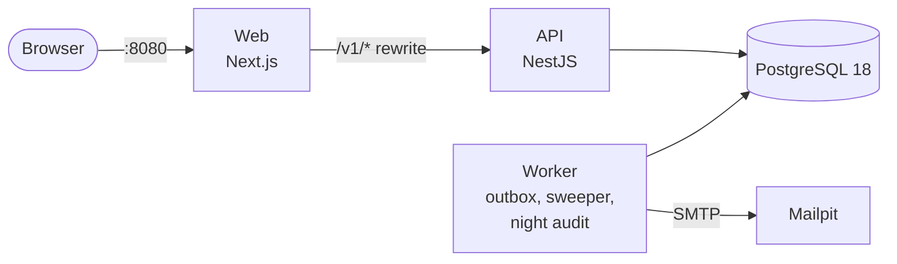

A modular monolith. The browser only talks to the web server, which forwards `/v1` to the API, so
the session cookie is first-party. The API and the worker are one codebase and one image, started
with different commands. Postgres is the only shared state: the queue, the rate limits and the
idempotency keys all live there, so there is nothing else to run or keep consistent.

The API is split into modules with clear owners: `identity` (accounts and sessions), `access`
(roles and teams), `properties`, `inventory` (rooms, prices, availability), `reservations` (holds,
bookings, the stay lifecycle), `frontdesk`, `guest-access` (private booking links) and
`notifications`. Cross-cutting pieces such as the outbox, idempotency, rate limiting and metrics
live in `platform`.

## Run it

You need Docker. From the repository root:

```sh
docker compose --profile full up -d --build --wait
```

This builds the images, runs the migrations, adds a demo hotel with bookings, and starts everything.

| What                    | Where                                |
| ----------------------- | ------------------------------------ |
| The app                 | http://localhost:8080                |
| Emails the app sends    | http://localhost:8025                |
| API reference (OpenAPI) | http://localhost:8080/v1/docs        |
| Demo hotel booking page | http://localhost:8080/stay/dar-nubia |

Sign in at http://localhost:8080/sign-in with any of the demo staff accounts. They share the
password `nubia-demo-password`:

| Account                 | Role       |
| ----------------------- | ---------- |
| `host@example.com`      | Owner      |
| `manager@example.com`   | Manager    |
| `frontdesk@example.com` | Front desk |

Stop with `docker compose --profile full down`. Add `-v` to delete the database too.

## Develop

You need Node 24 (see `.nvmrc`), pnpm 10 (`corepack enable`) and Docker.

```sh
pnpm install
docker compose up -d                       # Postgres and Mailpit only
cp apps/api/.env.example apps/api/.env
pnpm build                                 # the API and web app import the built contracts
pnpm db:migrate && pnpm db:seed            # schema and the demo hotel

pnpm dev                                   # API on :3000
pnpm dev:worker                            # outbox, sweeper and night audit
pnpm dev:web                               # web app on :3001
```

## Tests

| Suite      | Tool                    | Tests | What it covers                                                           |
| ---------- | ----------------------- | ----: | ------------------------------------------------------------------------ |
| API        | Vitest + Testcontainers |   511 | Unit tests, HTTP integration tests on a real Postgres, races, the worker |
| Web        | Vitest + jsdom + axe    |   242 | Components, views and their accessibility                                |
| Contracts  | Vitest                  |    41 | The shared Zod schemas                                                   |
| End to end | Playwright + axe        |    23 | Whole journeys on the Docker stack, desktop and phone, WCAG 2.2 AA scans |

```sh
pnpm test        # unit and integration tests (Docker must be running)
pnpm test:e2e    # end-to-end tests, against the stack from "Run it"
```

CI runs formatting, type checks, lint, every test suite, the builds, a migrations check and the
end-to-end suite on every pull request.

## Deployment

The live demo runs on one small Linux server (1 vCPU, 1 GB RAM) with Docker Compose, behind Caddy
for HTTPS. After CI passes on `main`, a GitHub Actions workflow pushes the images to GHCR and
deploys them over SSH, running the migrations first and waiting for every container to be healthy.
Server setup, secrets, backups and rollbacks are in [deploy/README.md](deploy/README.md).

## Project layout

```text
apps/
  api/          NestJS API and worker: src/modules, src/platform, migrations, tests
  web/          Next.js app: the guest booking site and the host dashboard
packages/
  contracts/    Zod schemas shared by the API and the web app
e2e/            Playwright end-to-end tests
deploy/         The production stack: Compose, Caddy, deploy and backup scripts
compose.yaml    Postgres and Mailpit for development; the whole stack with --profile full
```
